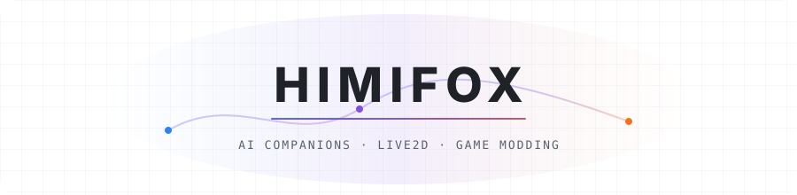

<picture>
  <source media="(prefers-color-scheme: dark)" srcset="./assets/header-dark.svg">
  
</picture>

### Hi, I'm Himifox.

I'm a student at **Shanghai University**, exploring AI companionship, Live2D, and game modding. I enjoy building characters that remember, respond, and take part in everyday interactions — from a shared web room to a farm in Stardew Valley.

  
  
  

 

## 🛠 Projects

### [NEKO-ONE](https://github.com/Himifox/NEKO-ONE)

A shared web room hosted by a Live2D character with a persistent persona, layered memory, and synchronized voice replies.

  

### [N.E.K.O-Himifox](https://github.com/Himifox/N.E.K.O-Himifox)

My fork of N.E.K.O., an AI companion platform with real-time voice, visual understanding, memory, and avatar interaction.

  

### [Yui to Issho!](https://github.com/Himifox/Yui-for-stawvalley)

A Stardew Valley companion mod. Yui follows you, chats, builds friendship, and helps with nearby farm work using her own tools and stamina.

  

### [Pardo-bot / NekoPardo](https://github.com/Himifox/Pardo-bot)

A QQ character companion with conversation memory, voice replies, and usage budgets.

  

[Browse my repositories →](https://github.com/Himifox?tab=repositories)

## 🎨 Toolbox

  

- **Characters & bots** · Live2D / PixiJS / NoneBot2 / OneBot V11
- **Game modding** · Stardew Valley / SMAPI
- **Development** · uv / Git

## 🌱 What I'm exploring

- **AI companionship** — Persistent identity, useful memory, and interactions that carry context over time.
- **Embodied characters** — Connecting conversation, voice, expressions, and actions through Live2D and game worlds.
- **Reliable interaction** — Keeping shared room state, saved progress, and multiplayer actions consistent.
