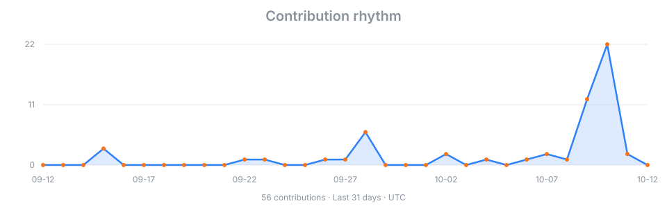

### Hello, I'm Himifox.

I'm a student at **Shanghai University** exploring AI companionship, Live2D, and game modding. I enjoy building characters that remember, respond, and take part in everyday interactions.

- Exploring persistent memory and personality in AI companions
- Bringing virtual characters to life with voice and Live2D
- Building a farm companion for Stardew Valley
- Debugging with `println` until the mystery gives up

 

---

### What I'm exploring

| AI companionship | Embodied characters | Open collaboration |
| :--- | :--- | :--- |
| Persistent identity, layered memory, and conversations that carry context over time. | Connecting voice, expressions, and actions through Live2D and game worlds. | Learning from real-world code and building on open-source projects. |

### Built with

  

  
  
  
  

  Projects: <a href="https://github.com/Himifox/NEKO-ONE">NEKO-ONE</a>, <a href="https://github.com/Himifox/N.E.K.O-Himifox">N.E.K.O-Himifox (fork)</a>, <a href="https://github.com/Himifox/Yui-for-stawvalley">Yui to Issho!</a>, and <a href="https://github.com/Himifox/Pardo-bot">Pardo-bot</a>.

### GitHub snapshot

  

 

  <i>Still learning. Still building. Still asking why it works on my machine.</i>

<picture>
  <source media="(prefers-color-scheme: dark)" srcset="./assets/footer-dark.svg">
  
</picture>
